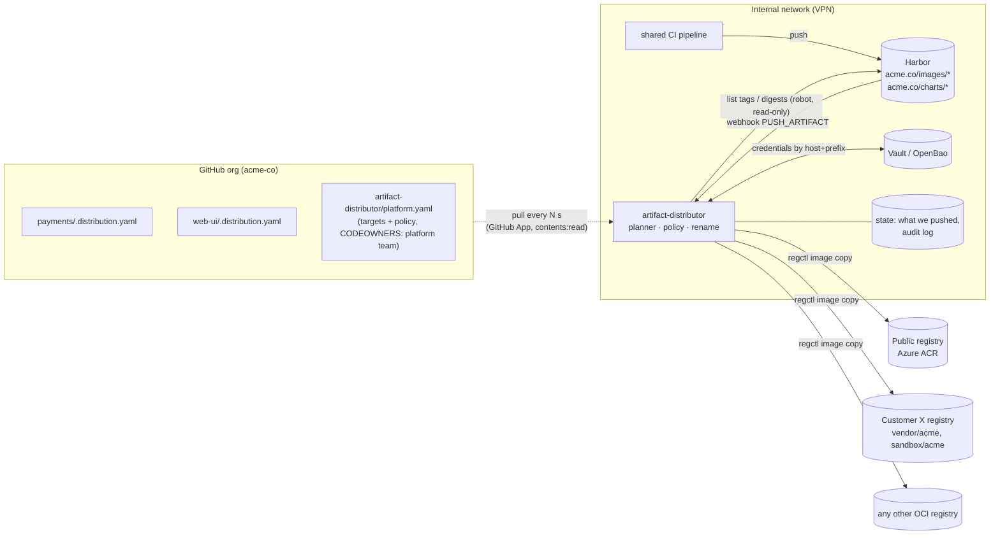

# Private artifact distributor — design

## 1. Problem

CI publishes every project's container image and/or Helm chart to a private Harbor
(`<harbor>/acme.co/images/<project>`, `<harbor>/acme.co/charts/<project>`), reachable only via VPN,
including pre-releases for in-field testing. A subset of those artifacts has to reach external
registries: a public Azure registry (as few artifacts as possible — it costs money) and arbitrary
private customer registries.

| # | Requirement | Where it is addressed |
|---|---|---|
| R1 | Distribute from Harbor to *any* OCI registry, automatically by pattern or on demand | §4 triggers, §5 selection |
| R2 | Projects with image+chart, image only, chart only | §5 (`artifacts:`; a missing repository is simply empty) |
| R3 | Public registry holds as little as possible | §8 cost control |
| R4 | Credentials in a secure store, resolved per registry host + namespace prefix | §7 |
| R5 | Any renaming, incl. single components (host, prefix, name, tag) | §6 |
| R6 | GitOps: developers control/trigger via a simple file in their repo | §3, §4 |

## 2. Options considered

| Option | Verdict |
|---|---|
| **Harbor replication rules** (push mode, managed by the `goharbor/harbor` Terraform provider) | Closest off-the-shelf fit, but renaming is limited to replacing the destination namespace and flattening path levels — no own-name or tag rename. Credentials live in Harbor's DB per endpoint, not in the central secret store, and are not chosen by namespace. Tag filters are glob/label only (no SemVer range, no "keep latest N"), deletion replication is all-or-nothing. Rules are owned centrally, not by developers in their repo. Good fallback for plain mirroring. |
| **regsync / skopeo sync / dregsy on a cron** | YAML is GitOps-friendly, but a single central file; credentials keyed by hostname only (docker `config.json`); no event trigger; no per-component rename beyond the target repo name; no policy layer. |
| **Each project's CI pushes to customers itself** | Customer credentials end up in every repository; re-distributing an existing artifact means re-running a build; no central audit or policy. Rejected. |
| **Small distributor service + GitOps files + proven copy engine** ✅ | A few hundred lines of orchestration around `regctl`. Meets every requirement and keeps secrets out of developer hands. Chosen. |

The copy itself is deliberately *not* reimplemented: `regctl image copy` (regclient) handles
multi-arch indexes, Helm/OCI artifacts with custom media types, cross-repo blob mounts, chunked
uploads, referrers, and the token flows of Harbor/ACR/ECR/GAR. It is isolated behind one module
(`engine.py`) and could be swapped for `crane` or `skopeo`.

## 3. Architecture



Two pieces of configuration with different owners:

* **`platform.yaml`** (platform team, central repo): the source, connection options per registry,
  the secret backend, named **targets** (`public`, `customer-x`, …) and a deny-by-default
  **policy** saying which project may write to which registry and repository path.
* **`.distribution.yaml`** (developers, in each project repo): *which* tags of *which* of the
  project's artifacts go to *which* target, *under which name*. No secret paths, no credentials.

Network reality drives one decision: Harbor and the distributor sit behind the VPN, so GitHub
cannot deliver webhooks to them. The service therefore **pulls** desired state (scans the org via
the GitHub API, or `git pull`s a list of repos). A self-hosted runner can additionally nudge it
right after a merge (`ci/github/distribution.yml`), purely to save the poll interval.

## 4. Triggers

| Trigger | Source | Scope | Latency |
|---|---|---|---|
| Harbor webhook `PUSH_ARTIFACT` | Harbor project webhook policy (shared-secret auth header) | the pushed project + kind | seconds |
| Config change | GitOps poller detects a changed `.distribution.yaml` | that project | ≤ poll interval |
| Periodic reconcile | timer | everything | heals lost webhooks, outages |
| On demand | `POST /api/v1/sync`, `distributor sync`, PR merge of a `tags.list` entry | project / rule / tag; includes `trigger: manual` rules | immediate |

Every trigger runs the same idempotent convergence: *plan* (desired state) → compare digests →
copy what differs → verify the destination digest → optionally prune. Running it twice is a no-op,
which is what makes the cheap "just reconcile" error handling safe.

"On demand" has two forms, both GitOps-compatible:
1. **Declarative**: add a tag to `tags.list` of a rule and merge — it gets distributed and stays
   distributed (and, with `prune`, disappears when removed from the list).
2. **Imperative**: a `trigger: manual` rule defines *where/how*; the *what* comes with the request
   (`{"project":"payments","rule":"pilot","tag":"dev-7f3a9c1"}`). Destinations are still subject
   to policy, and every request lands in the audit log.

## 5. Selection (what gets distributed)

```yaml
tags:
  include: ['v(?P<ver>\d+\.\d+\.\d+)-rc\.(?P<rc>\d+)']   # regex, full match; named groups become variables
  exclude: ['-dev']
  list: ["2.0.0-beta.1"]                                 # explicit tags
  semver: ">=1.3.0 <3"                                   # ranges, ^ ~ x, ||
  prerelease: exclude                                    # include | exclude | only
  keepLatest: 2                                          # newest N by SemVer precedence
artifacts: [image, chart]                                # default: both; missing repos are empty
platform: linux/amd64                                    # copy one platform out of a multi-arch index
```

An `auto` rule **must** select tags explicitly (include, list or semver) — there is no implicit
"everything", because the most expensive mistake is mirroring every CI build to the public
registry.

## 6. Naming / renaming

A reference is split into four independently renameable components:

```
harbor.acme.internal / acme.co/images / payments : v1.4.0
     registry              prefix         name      tag
```

Resolution per destination:
1. start from the source components;
2. a `target` replaces registry + prefix (the target's prefix is itself a template, e.g.
   `acme/${kind_dir}` so images and charts never share a repository);
3. per-component overrides — a template (`name: acme-${name}`) or a regex substitution of the
   source value (`tag: {regex: '^v', replace: ''}`); anything not overridden is inherited, so
   renaming *only* the host, *only* the tag, etc. is a one-liner;
4. or `ref:` — a whole-reference template, optionally using `${target_registry}` / `${target_prefix}`.

Variables: `registry prefix name tag` (source values), `project kind kind_dir target_registry
target_prefix`, SemVer parts `major minor patch prerelease version`, and named regex groups.
The result is validated against the OCI reference grammar; an unknown variable or an invalid
name is a plan error, not a broken push.

**Collision detection**: if two different sources would be written to the same destination
reference (e.g. image and chart of a project into one repository), neither is copied and the plan
reports the collision.

Helm note: renaming a chart repository works (`helm pull oci://host/path/new-name`), the chart's
internal `name` stays. Keep chart tags equal to the chart version — Helm resolves `--version` to the
tag (and stores `+` as `_`).

## 7. Credentials

Lookup key = `<registry>/<repository path>`, most specific first:

```
secret/registries/cr.customer-x.com/vendor/acme/images/acme-payments
secret/registries/cr.customer-x.com/vendor/acme/images
secret/registries/cr.customer-x.com/vendor/acme          <- found
secret/registries/cr.customer-x.com
```

So a registry can have one host-wide account, or a different account per namespace (ACR
repository-scoped tokens via scope maps, Harbor robot accounts per project, customers issuing one
account per tenant) — the platform team just writes the secret at the right depth. Developers only
name a target; they never see or reference secrets.

* Backends: **Vault / OpenBao KV v2** (token, AppRole or Kubernetes auth), a YAML file (dev, or
  decrypted by SOPS), or an env var. Azure Key Vault fits via the External Secrets Operator
  (AKV → Kubernetes Secret mounted for the file backend); a native backend is a small class implementing `get(key)`.
* The source (Harbor) uses the same mechanism: a read-only robot account at
  `registries/<harbor>/acme.co`.
* Secrets never touch a command line (`ps`): every `regctl` call gets a fresh `0600` config in a
  private temp dir containing only the hosts of that call, and an empty `DOCKER_CONFIG`.
* Cached for `cacheSeconds` (rotation = write a new version, it is picked up after the TTL);
  `Credentials.__repr__` never prints the secret; the audit log records *which key* was used.
* Least privilege: the distributor's Vault policy is read-only on `registries/*`.

## 8. Cost control for the public registry

* explicit tag selection is mandatory; SemVer ranges + `prerelease: exclude` keep CI noise out;
* `keepLatest: N` + `prune: true` — older tags **that this rule pushed** (tracked in the state DB)
  are deleted when they fall out of the selection; tags pushed by anyone else are never touched;
* `platform:` copies a single platform instead of the whole multi-arch index;
* referrers (signatures/SBOMs) are opt-in (`referrers: true`);
* digest comparison before every copy — nothing is re-uploaded; blobs already present (shared base
  layers) are skipped/mounted by regctl;
* backstop on the ACR side: retention policy for untagged manifests (pruning deletes tags).

## 9. Security & governance

* **Deny by default**: a destination is used only if `policy.allow` matches registry, repository
  glob and project. A developer cannot ship internal pre-releases to an arbitrary host.
* **Identity**: `requireProjectMatchesRepo` — repo `payments` can only distribute project
  `payments`.
* **Validation in PRs**: `distributor validate` (offline, GitHub-hosted runner) checks schema,
  regexes, SemVer, targets and policy; a self-hosted runner can post the live plan as a PR comment.
  `schema/distribution.schema.json` gives IDE completion.
* Webhook authenticated with a shared secret (Harbor "Auth Header"), API with a bearer token.
* Audit log (`/api/v1/events`): every copy, prune, denial and failure with source, destination,
  digest and credential key used.
* Broken config in one repo is reported (`/api/v1/projects`, metric `distributor_projects_rejected`)
  and skipped; it never blocks other projects.

## 10. Operations

* Kubernetes Deployment, 1 replica (convergence is idempotent, so a second replica during a
  rollout only costs duplicate digest checks); SQLite on a small PVC, or Postgres when HA is needed.
* Prometheus metrics: events by action, reconcile duration/timestamp, webhook counts, queue depth,
  rejected configs. Alert on `failed` events and on a stale `last_reconcile_timestamp`.
* Egress: allow-list the destination registries only.

## 11. PoC vs production

| Concern | PoC (docker-compose) | Production |
|---|---|---|
| Source | zot with Harbor's layout + a seeder that fires Harbor-format webhooks | Harbor; `poc/harbor/configure-harbor.sh` creates the robot account and webhook policy |
| Destinations | zot "customer" with per-namespace ACL, zot "public" | Azure ACR, customer registries |
| Secrets | OpenBao dev mode, token auth | Vault/OpenBao (Kubernetes auth) or Azure Key Vault |
| Config source | bind-mounted directory of repos | `configSource.type: github` (GitHub App) |
| TLS | plain HTTP | TLS everywhere |

## 12. Limitations / next steps

**Verified vs. not verified.** The end-to-end scenario (19 checks) runs against real OCI registries
(zot), a real OpenBao and real copies — in docker compose and with local binaries. Written but not
exercised against the real services: Harbor wiring (`configure-harbor.sh`), Azure ACR as a
destination, the `github` config source (org scan) and the GitHub Actions workflow.

**Destinations: "virtually any" means any OCI distribution-spec registry** (ACR, Harbor, GAR,
Artifactory, Nexus, Quay, GHCR, Docker Hub, zot, distribution). Known exceptions:
* **AWS ECR** — repositories must exist before the first push (ECR does not create them on push), and
  credentials are 12-hour tokens from `aws ecr get-login-password`, while the resolver currently
  returns static username/password. Next step: a `credentialHelper` field in the secret
  (e.g. `ecr-login`) and an optional "create repository" hook per target.
* **Classic (non-OCI) Helm repositories** — ChartMuseum or any `index.yaml`-over-HTTP repo cannot
  receive charts through the OCI API. Next step: a second engine that does `helm pull` + upload to
  ChartMuseum's API and regenerates the index; images are unaffected.
* Other short-lived credential schemes (GAR with a service-account key is fine; workload-identity
  tokens) follow the same `credentialHelper` path as ECR.

* One credential per host per copy: copying between two namespaces of the *same* host with
  different accounts needs one account with both rights (reported as a clear error).
* Pruning deletes tags; garbage collection of the blobs is the registry's job (ACR retention).
* No UI — the API, PR comments and the audit log cover the PoC; a small read-only page is easy.
* Not yet implemented: native Azure Key Vault backend, signing at the destination (cosign with a
  customer-specific key), notifications (Slack/Teams) on failures.
